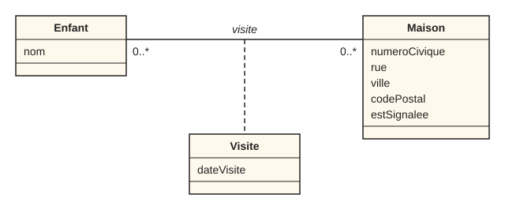
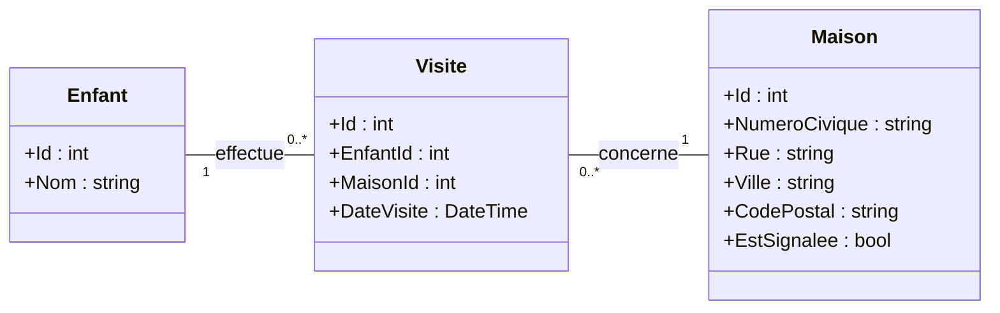

## Description de l'application
HalloWinUI est une application WinUI qui aide à organiser la tournée d’Halloween d’un quartier. Elle permet de gérer la liste des maisons à visiter :

- afficher les maisons sous forme de cartes, avec leur adresse ;
- ajouter une maison à l’aide d’un formulaire (numéro, rue, ville, code postal) ;
- supprimer une maison, après confirmation;
- signaler une maison jugée non sécuritaire, ce qui met à jour son statut.
- [d'autres fonctionnalités seront ajoutés pour aider à pratique la matière qui sera vue].

## Instructions
1. Faire une copie du gabarit (cliquez sur Use this template).
2. L'architecture MVVM doit être respectée (modèles, vues et modèles de vues, ainsi que l'utilisation de la liaison de données entre les vues et les modèles de vues).
3. Corriger et compléter le code de façon à :
	- Afficher toutes les informations des maisons.
	- Implémenter l'ajout d'une maisons, en entrant ses informations dans le formulaire, celle-ci doit apparaitre dans la grille des maisons.
	- Implémenter la suppression d'une maison en la séléctionnant, celle-ci doit disparaître de la grille des maisons. Vous devez ajouter une confirmation de suppression. Voir les notes de cours https://projets420.gitbook.io/asp.net/420-3p3-dev.-applications-windows/winui/elements-supplementaires#afficher-une-boite-de-dialogue-pour-confirmer-une-action
	- Afficher un statut "Signalé" ou "Sécuritaire" sur la carte, selon si on coche sur la case Signaler ou non.

4. Ajouter la navigation. Le menu de navigation doit contenir deux pages : « Maisons » et « Enfants ». La page « Maisons » doit s'afficher au démarrage.

5. Créer la page « Enfants » :
	- Compléter le fournisseur de données pour gérer les enfants (obtenir la liste). Ajouter quelques enfants au départ.
	- Afficher la liste de tous les enfants. Vous devez créer les modèles de vue nécessaires en respectant l'architecture MVVM.

6. Ajouter un enfant dans une page séparée :
	- Ajouter un bouton « Ajouter un enfant » dans la page « Enfants ». Ce bouton doit naviguer vers une nouvelle page contenant un formulaire.
	- Après l'enregistrement, revenir automatiquement à la page « Enfants ». Le nouvel enfant doit apparaître dans la liste.
	- Un bouton « Annuler » doit permettre de revenir à la page précédente sans rien enregistrer.

7. Compléter les fonctionnalités de suppression et de modification des informations des enfants.

8. Ajouter la validation dans les deux formulaires : à l'ajout d'une maison et à l'ajout d'un enfant.
    - Chaque champ invalide affiche les mesages d'erreurs clairs sous le champ.
    - Après un ajout réussi, le formulaire est vidé et les messages d'erreur disparaissent.
    - Optionnel : Le bouton d'ajout ou d'enregistrement est désactivé tant que le formulaire contient une erreur. 

        **Formulaire d'ajout d'une maison**
        
        | Champ | Validations |
        |---|---|
        | Numéro civique | Obligatoire ; chiffres uniquement ; de 1 à 6 caractères |
        | Rue | Obligatoire ; de 3 à 100 caractères |
        | Ville | Obligatoire ; de 2 à 50 caractères ; lettres, espaces, traits d'union et apostrophes seulement | 
        | Code postal | Obligatoire ; format canadien `A9A 9A9` (l'espace et les minuscules sont acceptés à la saisie) ; enregistré en majuscules avec l'espace |
        
        **Formulaire d'ajout d'un enfant**
        
        | Champ | Validations |
        |---|---|
        | Nom | Obligatoire ; de 2 à 50 caractères ; lettres, espaces, traits d'union et apostrophes seulement |

9. Implémentez la validation suivante : on ne peut pas ajouter une maison dont l'adresse (numéro civique, rue et ville) existe déjà dans la liste.

## Diagrammes de classes

### Diagramme conceptuel
Le diagramme conceptuel présente les concepts de l'application. Un enfant peut visiter plusieurs maisons, et une maison peut être visitée par plusieurs enfants. La visite, qui a sa propre date, est une classe d'association.

### Diagramme de conception
Le diagramme de conception présente les classes telles qu'elles sont codées. La classe d'association `Visite` devient une classe ordinaire, et la relation plusieurs-à-plusieurs est remplacée par deux relations un-à-plusieurs.

# Solution
- Afficher toutes les informations des maisons : 
    - On part de la vue .xaml pour trouver l'élément qui doit faire cet affichage (on le repère ou on le créé).
    - S'il s'agit d'une liste (ou d'un autre élément de collection, comme le GridView), on regarde s'il y a un DataTemplate définit et s'il est correct.
    - Chaque carte (un Item GridView.ItemTemplate de la collection GridView) doit afficher les informations d'une maison. La maison est une classe, on a besoin de créer le modèle de vue de cette classe pour l'utiliser dans le DataTemplate. ==> On créé donc un modèle de vue MaisonViewModel.
    - le DataTemplate sera donc de type MaisonViewModel `­<DataTemplate x:DataType="viewmodels:MaisonViewModel">`
    - Un item de la collection (GridView.ItemTemplate) doit afficher un ou plusieurs propriétés du modèle de vue MainViewModel, ici on veut d'abord afficher l'adresse complète. On va donc créer une liaison de données x:Bind avec la propriété AdresseComplete du modèle de vue MaisonViewModel.

- Implémenter l'ajout d'une maisons, en entrant ses informations dans le formulaire, celle-ci doit apparaitre dans la grille des maisons.
    - On complète le modèle de vue MainMaisonsViewModel avec les champs numéro, rue, ville et code postal et on créé la méthode Ajouter qui permet d'ajouter une maison à la collection observable des maisons.
    - On créée la liaison de données dans les champs du formulaire qui se trouve dans la vue MaisonsPage.xaml. On passe par le modèle de vue - ViewModel définit dans son le code behind - pour accéder aux propriétés Numero, rue, ville et code postal.
    - On créé l'élévement Click du bouton Ajouter, celui-ci appelle la méthode Ajouter du modèle de vue MainMaisonsViewModel.

- Implémenter la suppression d'une maison en la séléctionnant, celle-ci doit disparaître de la grille des maisons. Vous devez ajouter une confirmation de suppression. Voir les notes de cours https://projets420.gitbook.io/asp.net/420-3p3-dev.-applications-windows/winui/elements-supplementaires#afficher-une-boite-de-dialogue-pour-confirmer-une-action
    - Dans le modèle de vue MainMaisonsViewModel, créer une propriété qui va garder la maison sélectionnée depuis l'interface.
    - Aller dans la vue, trouver la liste des maisons (GridView) et lier l'élément sélectionné (attribut SelectedItem) à la propriété MaisonSelectionee du modèle de vue `SelectedItem="{x:Bind ViewModel.MaisonSelectionee, Mode=TwoWay}"`
    - Dans le modèle de vue MainMaisonsViewModel.cs, créer la méthode Supprimer qui permet de supprimer une maisons de la collection observable Maisons.
    - Créer l'événement Click du bouton Supprimer et l'implémenter en appelant la méthode Supprimer du ViewModel créée à l'étape précédente.

- Afficher un statut "Signalé" ou "Sécuritaire" sur la carte, selon si on coche sur la case Signaler ou non.
